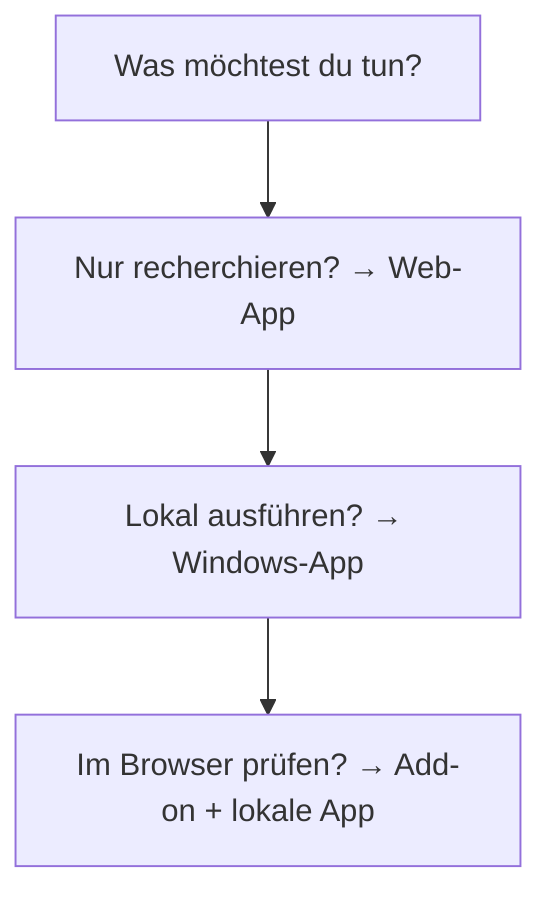
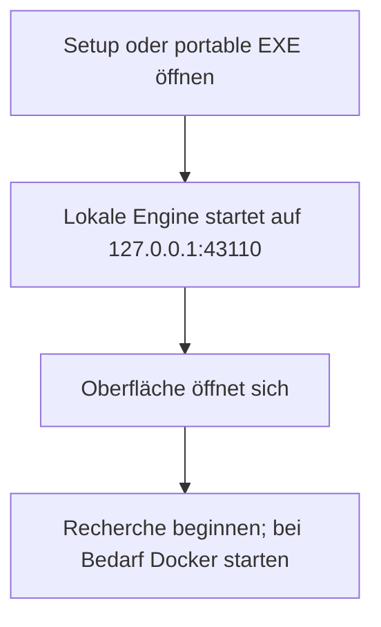
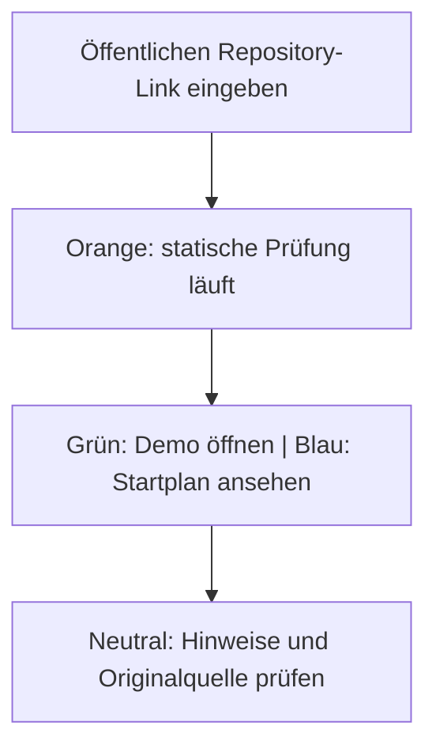
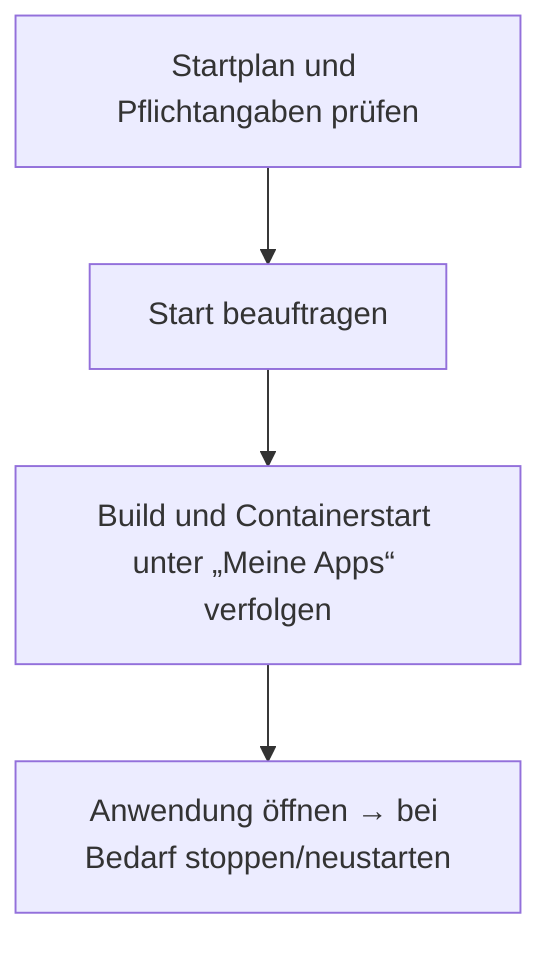
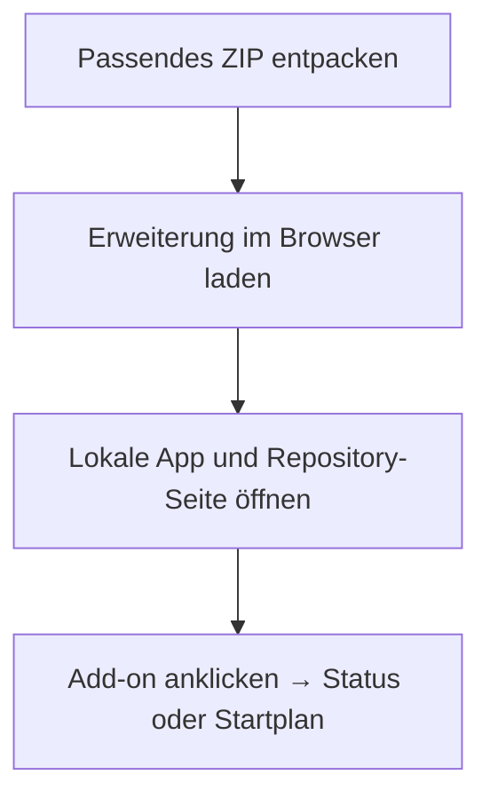
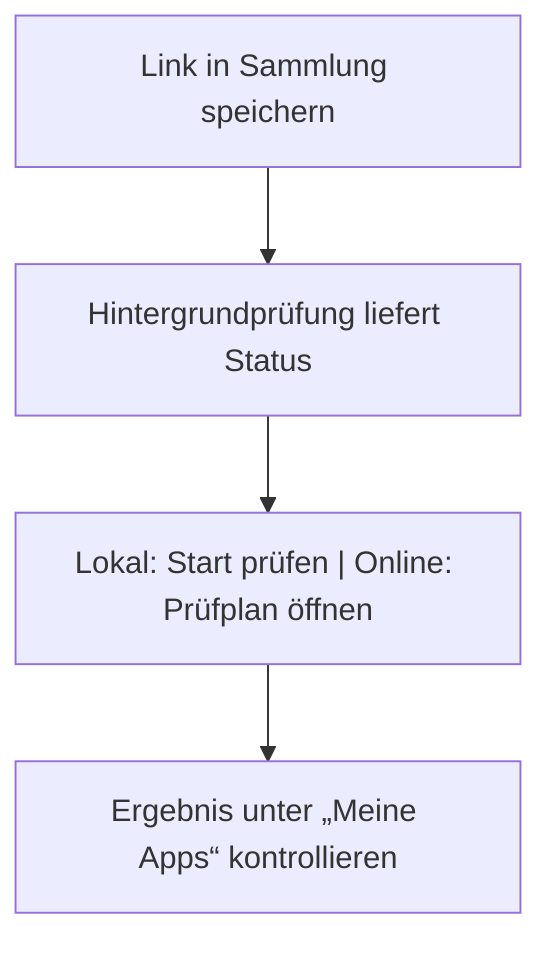
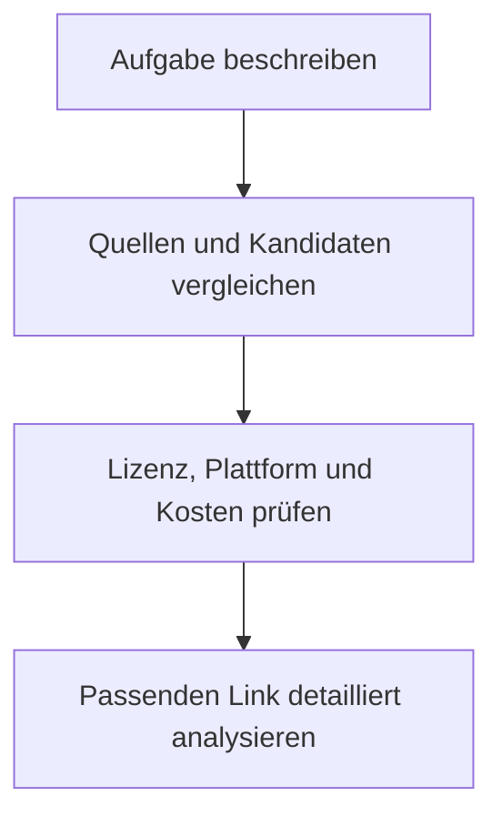
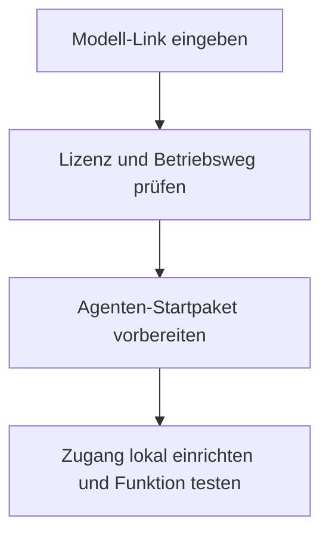
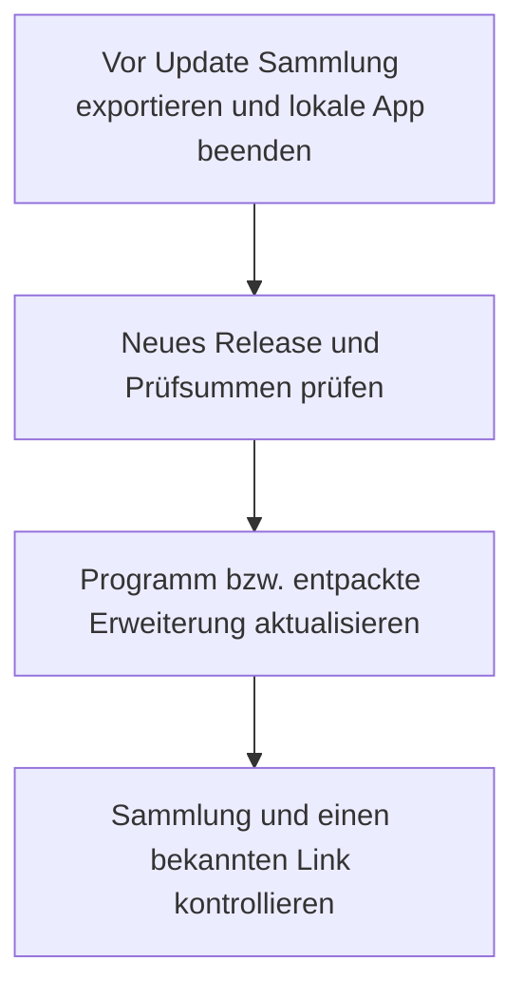
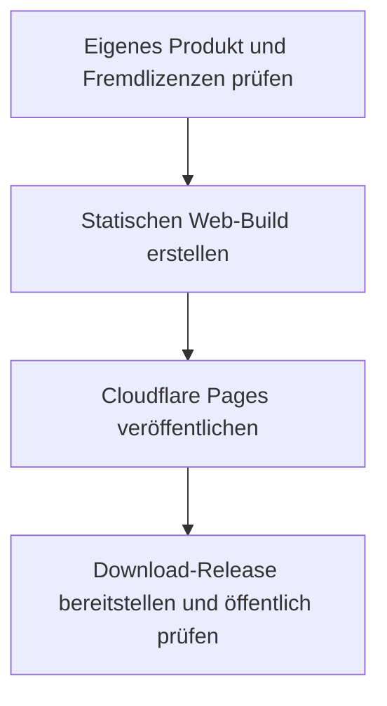

# aKlik-Deployer – Benutzerhandbuch 1.0.0

Web: https://aklik-deployer.pages.dev · Quellcode und Releases: https://github.com/Johi251/aKlik-Deployer

Stand: 25.10.2026. Pakete sind unsigniert. Browserpakete sind Entwicklerpakete, keine Store-Veröffentlichung.

## 1. Dein Werkzeugkasten

aKlik-Deployer hilft dir, vorhandene Software zu finden, Repository-Links zu prüfen und geeignete Projekte lokal zu starten. Die Web-App, die Windows-App und die Erweiterungen ergänzen sich.

1. Für Recherche ohne Installation: Öffne https://aklik-deployer.pages.dev.
2. Für lokale Projekte: Installiere die Windows-App aus dem Gesamtpaket.
3. Für Status direkt auf einer Repository-Seite: Lade die passende Browser-Erweiterung.
4. Bewahre das Gesamtpaket auf. Quellcode, Build-Skripte, Erweiterungen und dieses Handbuch gehören dazu.

Hinweis: Die Web-App führt kein Docker auf deinem PC aus. Ein öffentliches Repository ist noch kein Beleg, dass ein fremdes Projekt kostenlos und kommerziell nutzbar ist.

## 2. Windows installieren und starten

Die native Tauri-App öffnet ein eigenes Programmfenster. Die portable EXE stellt dieselben lokalen Funktionen in deinem Standardbrowser bereit. Beide verwenden dieselbe lokale Adresse.

1. Entpacke das Gesamtpaket vollständig in einen eigenen Ordner.
2. Öffne unter Windows die Datei Windows/aKlik-Deployer_1.0.0_x64-setup.exe für die Installation. Starte danach aKlik-Deployer.
3. Alternativ: Starte Windows/aKlik-Deployer-portable.exe. Dafür brauchst du Bun nicht separat.
4. Verwende jeweils nur eine der beiden Varianten zur selben Zeit.
5. Für Docker-Projekte muss Docker mit Linux-Containern laufen. Die Status-Bridge und Recherche brauchen Docker nicht.

Hinweis: Die Windows-Dateien sind nicht signiert. Prüfe Quelle und SHA256SUMS.txt. Das Handbuch fordert dich nicht auf, Schutzfunktionen abzuschalten. Das native Fenster benötigt WebView2.

## 3. Repository prüfen und Status verstehen

Öffne den Bereich zum Prüfen eines Repository-Links. Füge einen öffentlichen Projekt-Link ein und starte die Analyse. Die Prüfung liest Metadaten und ausgewählte Dateien; sie führt dabei keine fremden Startskripte aus.

1. Kopiere die Repository-Adresse von GitHub, GitLab oder einem Hugging-Face-Space.
2. Starte die Prüfung und warte auf den Endzustand.
3. Grün: Eine erreichbare Demo und eine erkannte Open-Source-Lizenz liegen vor.
4. Blau: Ein lokaler Startweg wie Docker, Compose oder ein Startskript wurde erkannt.
5. Orange: Die Prüfung läuft. Neutral: Der Startweg oder die Lizenz muss noch geklärt werden.

Hinweis: Ein Dockerfile beweist noch keinen erfolgreichen Start. Die ausführliche automatische lokale Installation unterstützt GitHub; bei GitLab und Hugging Face bleibt die Ausführung manuell.

## 4. Ein Projekt auf deinem PC starten

Die lokale App zeigt einen Startplan mit Lizenz, Voraussetzungen und möglichen Pflichtangaben. Erst der bewusste Start beauftragt die lokale Engine.

1. Starte Docker und öffne die lokale aKlik-Deployer-App.
2. Prüfe den GitHub-Link und lies Startplan, Lizenz und Hinweise.
3. Trage erforderliche Projektangaben nur lokal ein. Verwende keine fremden Zugangsdaten.
4. Wähle den angebotenen lokalen Start. Fehlende Pflichtwerte, ein gesperrter Plan oder unklare Lizenz verhindern den Start.
5. Verfolge den Fortschritt unter „Meine Apps“. Öffne erst bei laufender Anwendung die lokale Projekt-Adresse.
6. Nutze Stoppen bzw. Neustarten in „Meine Apps“. Das Schließen von aKlik-Deployer beendet bereits gestartete Container nicht automatisch.

Hinweis: Fremde Anwendungen laufen als Container, teilen aber Docker-Ressourcen mit deinem Computer. Prüfe fremden Code und Lizenz vor produktivem Einsatz. Host-Startskripte werden nicht ungeprüft ausgeführt.

## 5. Browser-Erweiterung einrichten

Pakete liegen für Chrome, Edge, Brave, Opera, Vivaldi und Firefox bei. Die fünf Chromium-Pakete verwenden dieselbe Erweiterungstechnik. Store-Veröffentlichung und Firefox-Signierung sind ein eigener Schritt.

1. Entpacke Browser-Erweiterungen/aklik-deployer-<browser>.zip in einen dauerhaften Ordner.
2. Chrome: chrome://extensions. Edge: edge://extensions. Brave: brave://extensions. Opera: opera://extensions. Vivaldi: vivaldi://extensions.
3. Aktiviere dort den Entwicklermodus und wähle „Entpackte Erweiterung laden“. Wähle den Ordner mit manifest.json.
4. Firefox: Öffne about:debugging#/runtime/this-firefox, wähle „Temporäres Add-on laden“ und die entpackte manifest.json.
5. Starte die lokale App, öffne eine unterstützte Repository-Seite und klicke auf das Erweiterungssymbol.
6. Das Add-on zeigt Status und einen Link zum passenden Startplan. Es startet selbst keine Container.

Hinweis: Das Firefox-Testpaket wird beim Browserneustart entfernt. Safari benötigt ein gesondertes Apple-Projekt und Signierung; dafür ist kein installierbares Paket enthalten. Andere Browser wurden nicht als Laufzeittest behauptet.

## 6. Lesezeichen und lokale Status-Badges

Der integrierte Bookmarks Manager ist über den Werkzeugkasten erreichbar. Zusätzlich liegen Bookmarks-Erweiterungen für Chromium und Firefox bei. Diese verwalten eine eigene Sammlung.

1. Öffne den Bookmarks Manager innerhalb der lokalen App oder unter https://aklik-deployer.pages.dev/bookmarks/.
2. Speichere oder importiere deine Links. Die optionale Lesezeichen-Datei liegt im Paket.
3. Warte beim Repository-Link auf den farbigen Status.
4. In der lokalen App kann „Lokal starten“ einen geeigneten GitHub-Startplan prüfen und den Start beauftragen.
5. In der gehosteten Web-App und der Erweiterung öffnet der blaue Status nur den Prüfplan.
6. Kontrolliere anschließend „Meine Apps“. Ein angenommener Startauftrag bedeutet noch nicht, dass die Anwendung bereits läuft.

Hinweis: Gehostete Webseiten und Erweiterungen erhalten keine allgemeine Schreibberechtigung auf die lokale Engine. Die Status-Bridge ist nur an die Loopback-Adresse gebunden.

## 7. Werkzeuge finden und vergleichen

Die Suche verbindet öffentliche Fundstellen und Projektinformationen. Sie hilft dir, vorhandene Lösungen zu vergleichen, bevor du ein neues Werkzeug installierst.

1. Beschreibe deine Aufgabe möglichst konkret, zum Beispiel „lokales Diagrammwerkzeug ohne Konto“.
2. Vergleiche mehrere Kandidaten nach Funktionen, Plattform, Lizenz und Startweg.
3. Öffne die Originalquelle und prüfe aktuelle Bedingungen.
4. Übernimm einen Kandidaten zur detaillierten Repository-Prüfung.
5. Für zusätzliche lokale Websuche kann SearXNG eingerichtet werden; das ist ein separater Docker-Dienst.

Hinweis: Katalogeinträge können veraltet sein. Eine kostenlose Liste garantiert keine kostenlose Nutzung der darin verlinkten Produkte.

## 8. KI-Modelle und Agenten vorbereiten

Der Modellbereich hilft bei der Einordnung eines Modell-Links und bei der Vorbereitung eines Agenten-Startpakets. Er ersetzt weder einen Anbieterzugang noch eine laufende Modellumgebung.

1. Öffne den Modellbereich und füge den Modell-Link ein.
2. Prüfe Modell, Anbieter, Lizenz und die Anforderungen an Hardware oder Cloud-Zugang.
3. Wähle ein passendes Profil und lade das angebotene Agenten-Startpaket herunter.
4. Lies dessen Anleitung, bevor du Befehle ausführst.
5. Richte eigene Zugangsdaten lokal ein und prüfe Anbieterpreise vor jeder kostenpflichtigen Nutzung.

Hinweis: Ein heruntergeladenes Startpaket ist noch kein laufender Agent. Die App verspricht keine kostenlose Modell-Inferenz und enthält keine persönlichen API-Schlüssel.

## 9. Daten sichern, aktualisieren und Fehler lösen

Web-App und lokale App speichern Daten an unterschiedlichen Orten. Ein Programmupdate ist kein Backup deiner persönlichen Sammlung.

1. Exportiere deine Lesezeichen regelmäßig mit der Exportfunktion des Managers.
2. Die lokale App legt ihre Daten unter dem Benutzer-Datenordner aKlik-Deployer ab, unter Windows normalerweise %LOCALAPPDATA%\aKlik-Deployer. Im Quellcodebetrieb ist es .data/.
3. Beende die lokale App vor einer Dateisicherung. Verwahre eine Datenbanksicherung vertraulich; bei SQLite gehören vorhandene WAL-/SHM-Dateien dazu.
4. Für Updates: Lade ein neues Release vom GitHub-Repository und ersetze die Programmdateien oder verwende den neuen Installer. Sichere Daten vorher.
5. Bei „lokale App nicht erreichbar“: lokale App starten, nur eine Instanz verwenden und Port 43110 prüfen.
6. Bei Docker-Fehlern: Docker starten, Pflichtangaben und Projekt-Logs prüfen. Bei Browserfehlern: neu laden, Internet und API-Limits prüfen.

Hinweis: Das Gesamtpaket enthält absichtlich keine persönliche Datenbank, Schlüssel oder Browserdaten. Es gibt keinen eingerichteten automatischen Desktop-Updater.

## 10. Kommerziell nutzen und selbst veröffentlichen

Die kommerzielle Web-Variante wird für Cloudflare Pages bereitgestellt. GitHub verwaltet den Quellcode und die Download-Releases. Die Vercel-Hobby-Seite bleibt eine Demo für nicht kommerzielle Nutzung.

1. Verwende für die kommerzielle Web-Veröffentlichung die Cloudflare-Adresse. Tarifgrenzen gelten; statisches Hosting ersetzt keinen Docker-Server.
2. Der eigene Quellcode bleibt dem Rechteinhaber vorbehalten. Die öffentliche Ablage erteilt anderen keine pauschale Weiterverkaufslizenz.
3. Remotion 4 erlaubt Einzelpersonen und kleinen Organisationen die kommerzielle Nutzung unter der Free License. Oberhalb der dortigen Grenze von drei Personen ist eine Company License nötig.
4. Behalte THIRD_PARTY_NOTICES.md, public/licenses.txt und Schriftlizenzen bei einer Weitergabe bei.
5. Für einen Geschäftsbetrieb: eigene Anbieterbedingungen, Datenschutzhinweise und erforderliche Betreiberangaben ergänzen. Zahlungsabwicklung ist kein Bestandteil dieses Tools.

Hinweis: Fremde Repository-Projekte haben eigene Lizenzen. Die App erteilt keine Rechte an deren Code. Kostenloses Hosting und kommerzielle Softwarelizenz sind getrennte Fragen.

## Quellen

- [Remotion-Lizenz](https://github.com/remotion-dev/remotion/blob/main/LICENSE.md)
- [Cloudflare Pages](https://www.cloudflare.com/products/pages/)
- [Cloudflare Tarifgrenzen](https://developers.cloudflare.com/pages/platform/limits/)
- [Cloudflare Bedingungen](https://www.cloudflare.com/terms/)
- [Vercel Hobby](https://vercel.com/docs/plans/hobby)