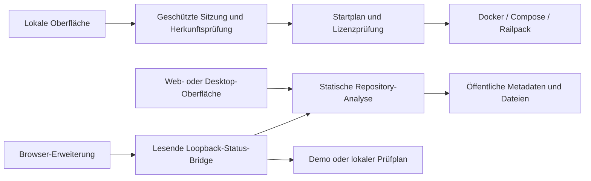
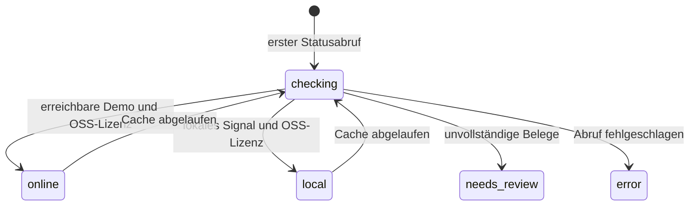

# aKlik-Deployer – technische Dokumentation

Web: https://aklik-deployer.pages.dev · Repository: https://github.com/Johi251/aKlik-Deployer

## Bestand und Datenfluss



| Bereich | Aufgabe |
| --- | --- |
| `src/` | TypeScript-Engine, lokale API, Scanner, Recherche und Web-Oberfläche |
| `src-tauri/` | Tauri-2-Fenster, Plattform-Installer, Engine als Sidecar |
| `extension/` | Status-Erweiterung mit activeTab und Loopback-Zugriff |
| `integrations/bookmarks-manager/` | eingebetteter Manager samt Erweiterungen |
| `public/` | Oberflächenvorlage, CSS, lokale Schriften, Lizenztexte |
| `scripts/` | reproduzierbare Builds, Paketierung und Prüfprogramme |
| `tests/` | automatisierte Funktions-, Sicherheits- und Oberflächentests |
| `.github/workflows/` | Prüfung und native Plattform-Builds |
| `docs/` | Benutzerhandbuch, diese Übergabe, kommerzielle Hinweise |

## Entwicklungsstart

Benötigt: Bun 1.4.2. Native Builds zusätzlich Rust und die offiziellen Tauri-2-Voraussetzungen
(https://v2.tauri.app/start/prerequisites/). Docker-Funktionen brauchen Docker mit Linux-Containern.

```sh
bun install --frozen-lockfile
cd integrations/bookmarks-manager
bun install --frozen-lockfile
cd ../..
bun run check
bun test
bun run build:companion
bun run dev
```

Lokal: http://127.0.0.1:43110. Die Weboberfläche beschafft eine HttpOnly-Sitzung.
Schreibzugriffe prüfen Sitzung, Origin und den App-Header. Daten und Schlüssel bleiben lokal.
Die öffentliche Web-Edition verwendet ausschließlich die Browser-API und kann kein Docker starten.

## Builds und Downloads

```sh
bun run release:web
bun run build:tauri
bun run verify:artifacts
python scripts/build-handbook.py
bun scripts/package-release.ts
```

`release:web` erstellt lokale Oberfläche, Manager, acht Erweiterungs-ZIPs, portable EXE,
Windows-Downloadteile und statische Web-Edition. `build:tauri` baut das native Paket auf
dem jeweiligen Betriebssystem; vier Plattformen sind im Desktop-Workflow vorgesehen.
`build-handbook.py` benötigt ReportLab und eine Unicode-Schrift (Segoe UI oder DejaVu Sans).
Die fertige Dokumentation ist bereits im Repository enthalten; CI braucht Python dafür nicht.
`package-release.ts` erwartet vorhandene Windows-Installer, den Web-Build und die Dokumentation.
Quellpakete werden über die feste Auswahl in `source-files.ts` erzeugt. Laufzeitdaten,
Geheimdateien, Abhängigkeiten und Build-Caches werden ausgeschlossen.

## Cloudflare Pages

Kostenloser statischer Build. Projektname: `aklik-deployer`. Ausgabe:
`sites/aklik-deployer-online/dist`. Maximal 25 MiB pro Datei; die größere portable EXE
wird im Browser aus Teilen mit je höchstens 8 MB und SHA256-Prüfung zusammengesetzt.
Große Gesamtpakete, Installer und Plattformdownloads gehören in GitHub Releases.

```sh
bun run release:web
npx wrangler pages deploy sites/aklik-deployer-online/dist --project-name=aklik-deployer --branch=main
```

Das benötigt einen eigenen Cloudflare-Zugang. Für automatische Deployments verwendet
`.github/workflows/cloudflare.yml` das Repository-Secret `CLOUDFLARE_API_TOKEN` und die
Variable `CLOUDFLARE_ACCOUNT_ID`. Es werden keine Zugangsdaten in Dateien eingecheckt.
Pull Requests bauen und testen ohne Cloudflare-Schlüssel; nur Pushes auf main veröffentlichen.
Für spätere Betreiber nach Möglichkeit ein auf Pages dieses Kontos beschränktes Token nutzen.

## Bridge-Protokoll

- Adresse: `http://127.0.0.1:43110` (nur Loopback).
- `GET /bridge/v1/health`: Produkt, Version und Protokoll.
- `GET /bridge/v1/status?url=<URL>`: HTTP 202 während Prüfung, danach HTTP 200.
- Protokoll: `aklik-deployer.status.v1`.
- Felder: `state`, `color`, `label`, `evidence`, `checkedAt`, `launchUrl`, `inspectUrl`,
  `localReady`, `onlineReady`, `deploymentCandidate`, `runtimeTested`, `note`.
- Vier parallele Checks, fünf Minuten Cache, maximal 128 Cache-Einträge.
- Keine schreibenden Bridge-Endpunkte. Zusätzliche Origins nur explizit per
  `AKLIK_DEPLOYER_BRIDGE_ORIGINS`; kein pauschaler Zugriff gehosteter Seiten.



## Veröffentlichung und Wartung

Vor Veröffentlichung: Tests, Typprüfung, Artefaktprüfung, Geheimwertscan und Prüfung
des Quellpaket-Inhalts. Versionen in package.json, Manifesten, Rust und Tauri gemeinsam
pflegen. Desktop-Updater und Code-Signing sind nicht eingerichtet. Firefox-Dauerverteilung
benötigt Mozilla-Signierung; Chromium-Store-Veröffentlichungen sind eigene Vorhaben.

Die Mac-Builds lassen sich über den kostenlosen Standard-Runner des öffentlichen
GitHub-Repositories erstellen. Ein erfolgreicher Build ersetzt keinen Test auf einem
echten Mac mit Benutzeroberfläche. Ebenso sind Paketprüfung und tatsächlicher Browser-
Erweiterungstest getrennte Nachweise.
